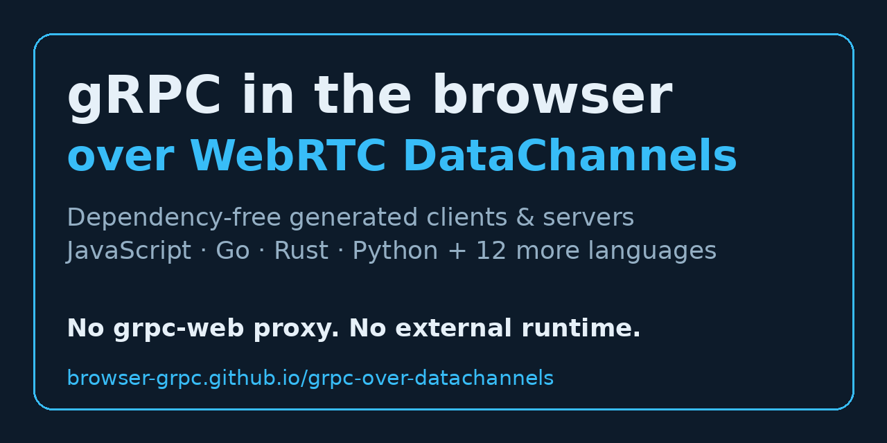
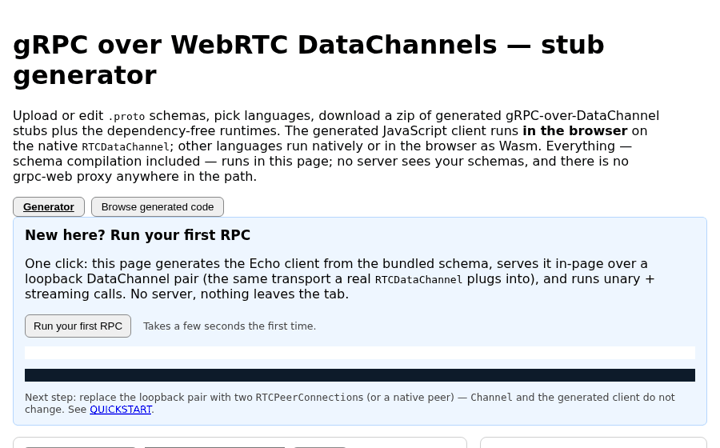

# gRPC over WebRTC DataChannels — in the browser and natively

**New here? Start with [QUICKSTART.md](QUICKSTART.md)** — your
first browser RPC in about five lines, a Docker client/server
pair, and stubs for your own `.proto`. Or open the
[live generator](https://browser-grpc.github.io/grpc-over-datachannels/app/)
(also at [grpc-dc.lunchgamer.com](https://grpc-dc.lunchgamer.com/))
and press **Run your first RPC**.

**Run gRPC in the browser.** grpc-over-datachannels speaks the
gRPC wire protocol directly over WebRTC DataChannels, so a
browser tab can call native services peer-to-peer — no grpc-web
proxy, no translating gateway, no external gRPC runtime.
Generate dependency-free gRPC clients and servers for
JavaScript (browser + Node), Go, Rust, Python, and 12 more
languages from the same `.proto` schemas. Browser clients use
the native `RTCDataChannel`; other languages also run in the
browser as Wasm. Every runtime is generated and dependency-free,
on a reimplemented WebRTC stack (ICE/DTLS/SCTP) with native and
browser clients and servers.

Try the [live in-browser generator](https://browser-grpc.github.io/grpc-over-datachannels/app/):
paste a `.proto`, get protoc stubs for every language. Keywords:
`grpc`, `grpc-web alternative`, `webrtc`, `datachannel`,
`rtcdatachannel`, `protobuf`, `protoc plugin`, `wasm`,
`browser rpc`, `peer-to-peer`.

This repository is a generated public export (version v0.35.1)
of the grpc-over-datachannels project. Generated code may be used
without restriction (see GENERATED-CODE-LICENSE.md); everything
else is Apache-2.0 (see LICENSE).

## Languages

| Language | Runtime + stubs |
|---|---|
| C | [`c/`](c/) · [readme](c/README.md) · [gallery](docs/gallery.html#c) |
| C++ | [`cpp/`](cpp/) · [readme](cpp/README.md) · [gallery](docs/gallery.html#cpp) |
| C# | [`csharp/`](csharp/) · [readme](csharp/README.md) · [gallery](docs/gallery.html#csharp) |
| Dart | [`dart/`](dart/) · [readme](dart/README.md) · [gallery](docs/gallery.html#dart) |
| Go | [`go/`](go/) · [readme](go/README.md) · [gallery](docs/gallery.html#go) |
| Java | [`java/`](java/) · [readme](java/README.md) · [gallery](docs/gallery.html#java) |
| JavaScript | [`js/`](js/) · [readme](js/README.md) · [gallery](docs/gallery.html#js) |
| Kotlin | [`kotlin/`](kotlin/) · [readme](kotlin/README.md) · [gallery](docs/gallery.html#kotlin) |
| Lua | [`lua/`](lua/) · [readme](lua/README.md) · [gallery](docs/gallery.html#lua) |
| PHP | [`php/`](php/) · [readme](php/README.md) · [gallery](docs/gallery.html#php) |
| Python | [`python/`](python/) · [readme](python/README.md) · [gallery](docs/gallery.html#python) |
| Ruby | [`ruby/`](ruby/) · [readme](ruby/README.md) · [gallery](docs/gallery.html#ruby) |
| Rust | [`rust/`](rust/) · [readme](rust/README.md) · [gallery](docs/gallery.html#rust) |
| Scala | [`scala/`](scala/) · [readme](scala/README.md) · [gallery](docs/gallery.html#scala) |
| Swift | [`swift/`](swift/) · [readme](swift/README.md) · [gallery](docs/gallery.html#swift) |
| Zig | [`zig/`](zig/) · [readme](zig/README.md) · [gallery](docs/gallery.html#zig) |
| WebRTC stack | [`webrtc/`](webrtc/) |
| Wasm facades + native Wasm | [`wasm/`](wasm/) |

## Getting started (Docker, no toolchain install)

Every language's test suite in one command pair:

    docker build -f docker/rust.Dockerfile -t grpc-dc-rust .
    docker run --rm grpc-dc-rust
    docker build -f docker/go.Dockerfile -t grpc-dc-go .
    docker run --rm grpc-dc-go
    docker build -f docker/js.Dockerfile -t grpc-dc-js .
    docker run --rm grpc-dc-js
    docker build -f docker/python.Dockerfile -t grpc-dc-python .
    docker run --rm grpc-dc-python
    docker build -f docker/java.Dockerfile -t grpc-dc-java .
    docker run --rm grpc-dc-java
    docker build -f docker/csharp.Dockerfile -t grpc-dc-csharp .
    docker run --rm grpc-dc-csharp
    docker build -f docker/cpp.Dockerfile -t grpc-dc-cpp .
    docker run --rm grpc-dc-cpp
    docker build -f docker/swift.Dockerfile -t grpc-dc-swift .
    docker run --rm grpc-dc-swift
    docker build -f docker/kotlin.Dockerfile -t grpc-dc-kotlin .
    docker run --rm grpc-dc-kotlin
    docker build -f docker/dart.Dockerfile -t grpc-dc-dart .
    docker run --rm grpc-dc-dart
    docker build -f docker/zig.Dockerfile -t grpc-dc-zig .
    docker run --rm grpc-dc-zig
    docker build -f docker/c.Dockerfile -t grpc-dc-c .
    docker run --rm grpc-dc-c
    docker build -f docker/lua.Dockerfile -t grpc-dc-lua .
    docker run --rm grpc-dc-lua
    docker build -f docker/ruby.Dockerfile -t grpc-dc-ruby .
    docker run --rm grpc-dc-ruby
    docker build -f docker/php.Dockerfile -t grpc-dc-php .
    docker run --rm grpc-dc-php
    docker build -f docker/scala.Dockerfile -t grpc-dc-scala .
    docker run --rm grpc-dc-scala

Or `docker compose up` for the cross-language interop proof
plus the browser demo on http://localhost:8080 (generator with
a schema preloaded: http://localhost:8080/app/#schema=echo&lang=go).

## Try it in the browser

The [live generator](https://browser-grpc.github.io/grpc-over-datachannels/app/)
runs the real protoc plugins in your browser (schema in,
generated code out, for every language) and the app's Browse tab
shows generated clients — including a JavaScript browser client
on the native `RTCDataChannel` — for every bundled schema. No
server, no install. Deep link to the JavaScript client:
https://browser-grpc.github.io/grpc-over-datachannels/app/#schema=echo&lang=js

Browser examples in every Wasm language (Echo client in
the page, generated server on the Node stack):

    docker compose --profile browser-examples up   # http://localhost:8080/
    docker compose --profile tunnel-browser up     # same, on a public URL

## Generate with protoc (Node)

The same generators ship as a dependency-free Node protoc
plugin, `docs/app/protoc-gen-grpc-dc.mjs`. Link it under one
name per language and generate natively:

    ln -s "$PWD/docs/app/protoc-gen-grpc-dc.mjs" ~/bin/protoc-gen-grpc-dc-rust
    protoc --plugin=protoc-gen-grpc-dc-rust=$HOME/bin/protoc-gen-grpc-dc-rust \
           --grpc-dc-rust_out=out -I . echo.proto

## IoT / embedded

The WebRTC stack under `webrtc/rust` is `no_std` (it cross-builds
for Cortex-M): platform traits inject clock, entropy, and the
datagram transport, and an in-crate net stack provides Ethernet
framing, ARP, IPv4/IPv6, UDP, and DHCP — WebRTC with no OS at
all. Two-device bring-up over a virtual cable, power-on to
DataChannel echo:

    cargo run --example iot_cable   # in webrtc/rust

Small generated runtimes (C99, Lua) target constrained hosts;
every generated runtime is dependency-free.

## Single-socket serving (PeerMux)

The Rust, Go, and JS (Node) stacks can host many signaled
peers on one bound UDP socket: `PeerMux` routes STUN by ICE
ufrag, the first DTLS flight by a pair-hint extension, and
every later DTLS record by its RFC 9146 connection id, so
a server needs exactly one open port for all its peer
connections (the single-port topology of Jitsi/Pion) —
and two muxes can peer with each other, since records no
longer route by source address. TURN also works on muxed
peers (the allocation's UDP leg rides a dedicated per-peer
socket). See `webrtc/rust/src/mux.rs`,
`webrtc/go/mux.go`, `webrtc/js/mux.js`; one generated
scenario tests all three stacks, and the cross-stack
matrix pairs mux against mux across stacks.

Stuck? See [docs/TROUBLESHOOTING.md](docs/TROUBLESHOOTING.md)
(secure context, signaling, TURN/NAT, WebKit fallback, transports).

## Verify the browser story

The `browser-test/` directory carries the real-browser
harness (Playwright). From a clone:

    cd browser-test && npm ci && npx playwright install chromium
    node bdd.test.mjs all   # BDD scenarios in a real browser

Suites needing Rust harness binaries or TURN servers say
so in their headers; the BDD suite is self-contained.

No install, on any device: `docker compose --profile tunnel up`
serves this site through a temporary Cloudflare quick tunnel and
prints a public `https://*.trycloudflare.com` URL (WebRTC needs
the HTTPS secure context off localhost). The URL is random per
run and demo-only; DataChannel traffic stays peer-to-peer and
never passes through the tunnel.

## Behavior specification

The wire behavior is specified as generated BDD scenarios; see
[BDD.md](BDD.md) (also rendered under `docs/`). The same scenario
table runs natively in every language above and in real browsers.

## Provenance

Exported from source commit `c1585aff8537bc91a96f9a5c129130d5f0b8096d` by the project's
code generator. This tree contains no build system: each language
directory carries its runtime, generated stubs, examples, and
tests in that language's usual layout.
